# ObsidiNote


**Our own web interface on top of OneNote: a personal wiki that files and links itself.** ObsidiNote is a small web portal that you host yourself. It runs on your own PC (a local server that only this PC can reach, opened in its own Edge window), and it uses a OneNote notebook of yours as its data store. OneNote holds the pages; ObsidiNote is the interface you work in.

In that interface you paste a link, a mail, a file or a few lines, or pick today's Teams meetings. Microsoft 365 Copilot decides what it is, which topics it belongs to and which of your pages it relates to, and ObsidiNote writes it as a page into your notebook through desktop OneNote. Ask a question and the answer cites your own pages. A knowledge graph shows how everything connects. The pages stay ordinary OneNote pages: you can still open, read and edit them in OneNote itself.

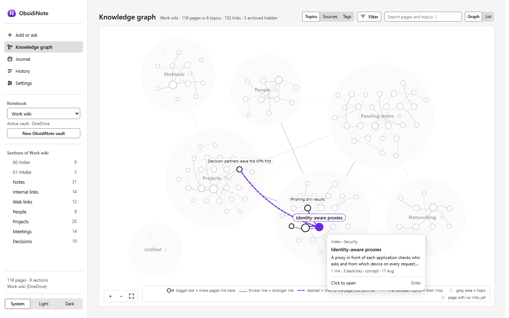

- **Self-hosted.** The portal runs on your PC and nowhere else: no web service, no extra account beyond your Microsoft 365 one.
- **OneNote is the storage.** Your pages, ObsidiNote's index and the vault's settings all live in your OneNote notebook. ObsidiNote keeps no copy on disk.
- **No install rights needed.** It runs on Windows PowerShell 5.1, desktop OneNote and Edge, all already on a Microsoft 365 PC.
- **Copilot does the filing.** You add; ObsidiNote checks every answer against your index before anything is written.

## Contents
- [Requirements](#requirements)
- [Install](#install)
- [First start](#first-start)
- [Using ObsidiNote](#using-obsidinote)
- [Updates](#updates)
- [When something does not work](#when-something-does-not-work)
- [Privacy](#privacy)
- [Settings and options](#settings-and-options)
- [For developers](#for-developers)

## Requirements
- Windows with Windows PowerShell 5.1 (built in). No admin rights.
- Desktop OneNote (Microsoft 365). ObsidiNote starts it when it is not running.
- Microsoft Edge and a Microsoft 365 account with Copilot Chat.

## Install
1. Open PowerShell (no admin) and run:
   ```powershell
   powershell -NoProfile -ExecutionPolicy Bypass -Command "irm https://raw.githubusercontent.com/jgt87/ObsidiNote/main/install.ps1 | iex"
   ```
   This puts the latest release in `%LOCALAPPDATA%\Programs\ObsidiNote` and adds an **ObsidiNote** shortcut to the desktop and the Start menu.
2. Start **ObsidiNote** from that shortcut.

Without the installer: download `ObsidiNote-vX.Y.Z.zip` from [Releases](https://github.com/jgt87/ObsidiNote/releases), check it against `SHA256SUMS`, unpack it and double-click `Start ObsidiNote.cmd`.

## First start
A console window opens and shows one line per step, each `[OK]`, `[WARN]` or `[FAIL]` with what to do:

1. **Update**: installs a newer release if there is one, then goes on with it.
2. **This computer**: PowerShell, OneNote, Edge and its policies.
3. **OneNote**: opens your vault's notebook (and OneNote itself when needed). If OneNote has another notebook selected and the vault's pages cannot be read, ObsidiNote selects the vault's notebook once.
4. **Vault**: opens your ObsidiNote vault and checks its index. The first time there is none yet: see [Make your first vault](#make-your-first-vault).
5. **Copilot**: opens Microsoft 365 Copilot in an Edge window of its own (its own profile, so your normal Edge is not touched). **Sign in once** there and choose "Stay signed in". Later starts reuse it.
6. **ObsidiNote**: opens the ObsidiNote window at `http://127.0.0.1:8767`.

**Keep the console window open while you work; closing it stops ObsidiNote.** Starting ObsidiNote again while it runs replaces the running one.

**Work or school account:** run `sso-setup.cmd` (in the ObsidiNote folder) once. It turns on single sign-on for ObsidiNote's own Edge profile only, so Copilot signs in with your Windows account by itself. It asks first, stores no password, and `sso-setup.cmd -Off` turns it off again.

### Make your first vault
A vault is the OneNote notebook ObsidiNote writes into, with its fixed sections (`Notes`, `Meetings`, `Decisions`, `Internal links`, ...) and its own index.

1. In the side bar choose **New ObsidiNote vault** and give it a name. ObsidiNote makes the notebook next to your other cloud notebooks and makes it the active vault.
2. Or tick **Inside an existing notebook**: the vault becomes a section group there. ObsidiNote asks before it writes into that notebook and leaves the rest of it alone.
3. An empty notebook you already made can be set up as a vault from the side bar too.

Next starts continue in that vault. To use a vault made on another PC, open its notebook in OneNote and choose it under **Notebook** in the side bar.

## Using ObsidiNote

### Add something, or ask
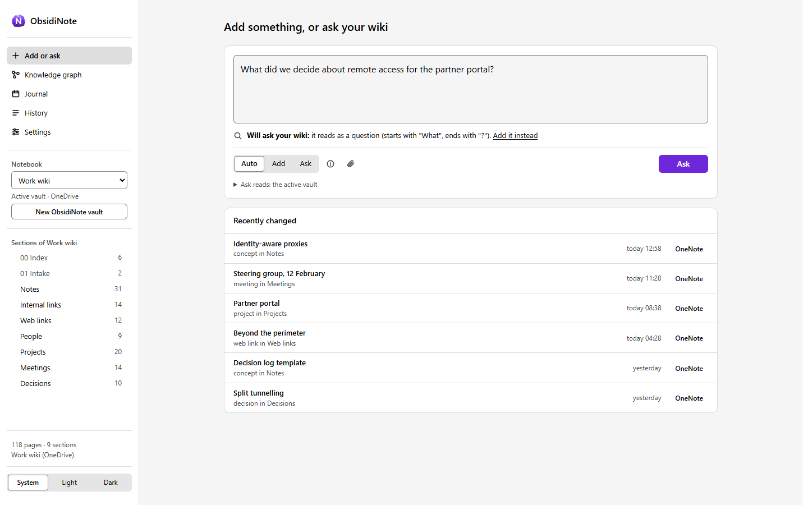

One box does both. In **Auto** it says before you send whether it will add or ask, and why: questions ("Can we…", "Summarize…", "Kan ik…", a question after pasted text) are asked, notes, mails, lists and longer text are added. When it cannot tell, it offers **Search your wiki** or **Add as a note**. Switch to **Add** or **Ask** yourself any time (`Ctrl+1`, `Ctrl+2`). `Enter` sends, `Shift+Enter` adds a line. The paperclip next to the mode switch adds a file.

### Add
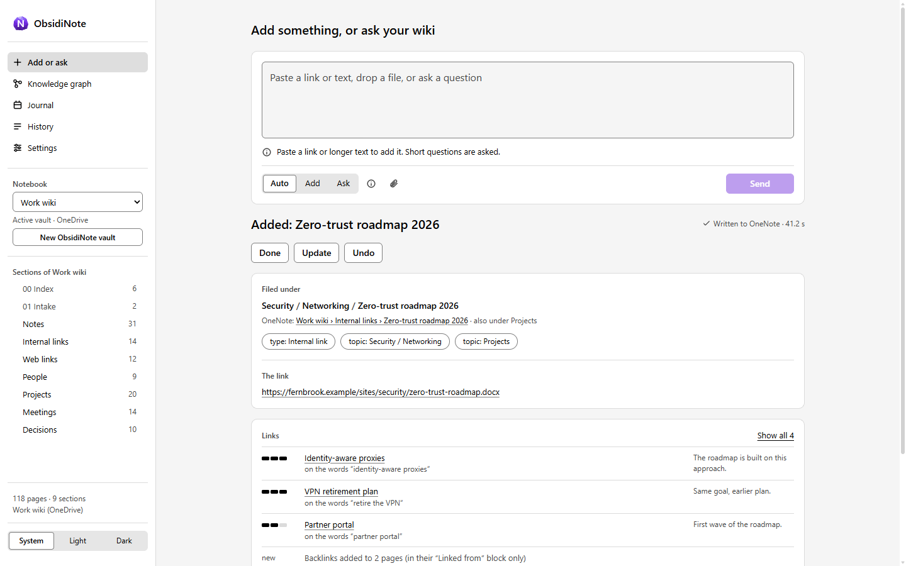

- **Text**, a **link**, a **mail** or **chat** you paste, or a **file** you drop on the box (Word, PowerPoint, Excel, PDF with text, Outlook `.msg`, `.eml`, text, web pages).
- Copilot picks the type, the topics and the related pages; ObsidiNote writes the page into the right section of your vault, adds links to related pages ("Linked from" on theirs) and updates the index.
- A pasted **link** becomes one summary page (SharePoint, OneDrive, Teams and Loop under `Internal links`, the rest under `Web links`). The same link again updates its page; **Update** reads the source again and shows old against new. Your own "Your notes" part of a page is never changed. Paste a SharePoint, OneDrive or Teams link **with your own words** and you get both: the page's summary, and your words under "Your notes".
- **Undo** moves the page to OneNote's Deleted Pages and takes its links out of the pages that pointed to it.
- A **journal entry** (what happened, what you did or decided) goes into that day's journal page, one page per day; its Undo takes out only that entry.
- When a page with the same title and type is already there, nothing is added: **Open it**, or **Add anyway** to add yours beside it.
- When Copilot needs longer than about two minutes (a large SharePoint page), nothing is lost: the item waits under **Waiting for Copilot** and **Check for the answer** finishes it later.

### Today's meetings
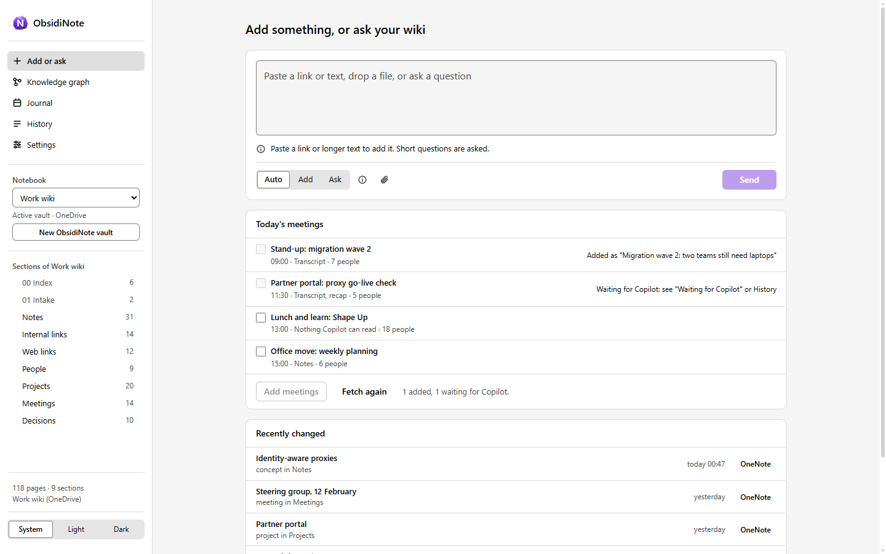

Under the box, **Fetch today's meetings** has Copilot list your Teams meetings of today (with Work IQ, so it sees your own calendar) and say which ones it can read: a transcript, a Copilot recap or meeting notes. Those are ticked for you. Press **Add**: each ticked meeting becomes a page under **Meetings** with its attendees (name and e-mail address), summary, decisions and actions. Each one is added like any other Add, so it is linked to your other pages, listed in **History** and can be undone. Each row says where it is ("reading", "adding", "Added as ...", or why it was not added). Nothing is written before you press **Add**.

**Meeting series.** A meeting that recurs (a daily stand-up) is one series: each day gets its own page, "‹meeting› · ‹date›", linked to the day before, with the meeting's own start time. Importing the same day again updates that day's page. In the **Journal**, search for the meeting and pick "Meetings: ‹name›" to see the series day by day.

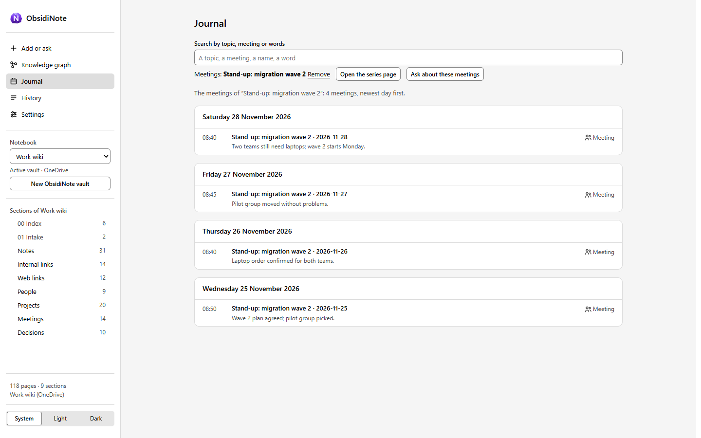

**Ask within a series.** **Ask about these meetings** (Journal) or **Ask about this series** (a meeting's page window) limits the next questions to that series. The box shows it, with **Remove**. ObsidiNote picks those meeting pages itself, up to 50, newest first, and Copilot answers from them only, citing them.

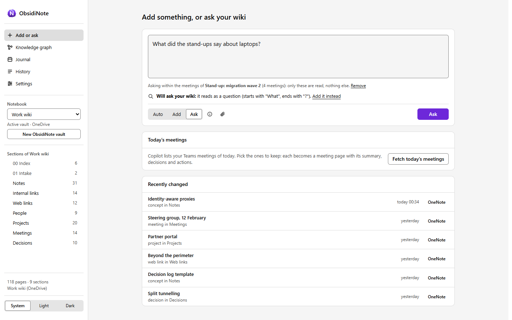

### Ask
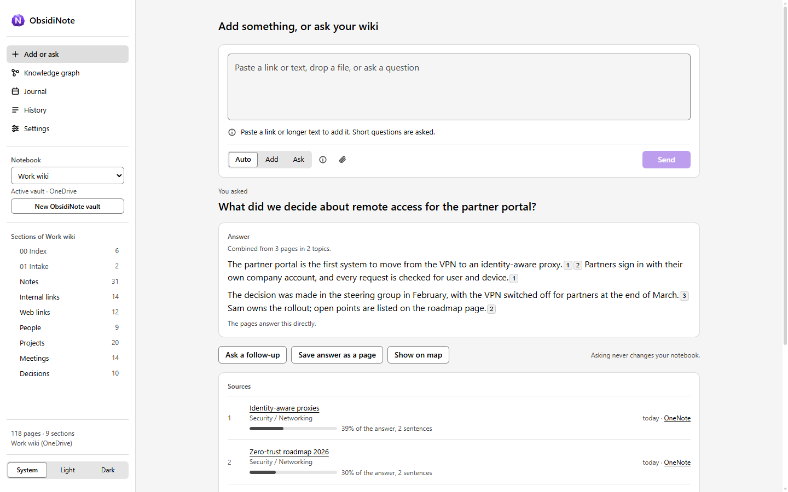

- The question walks your index (topics, then pages, then their text) and every sentence of the answer cites your own pages. A citation number opens that page's window (a link page opens its own address); each source also opens in OneNote.
- **Ask a follow-up**, **Save answer as a page**, or **Show on map** to see the sources in the graph.
- Ask can also read other vaults and notebooks you have open, read only. Asking never changes your notebook. Ask switches Copilot's Work IQ off, so it does not draw on your mail, chats or files.

### Knowledge graph
The map above shows every page as a dot in its topic's area. Bigger dots have more pages linking to them; lines are links, thicker for stronger ones.

- Point at a dot for a preview, click it for the page window. `/` searches; search understands `type:meeting`, `topic:"Security / Networking"`, `tag:licensing`, `site:example.org`, `after:2026-03`, `is:unlinked`.
- **Topics | Sources | Tags** groups the dots by topic, by where they came from (each SharePoint site, OneDrive, Teams, web sites), or by your tags.
- **Filter** narrows by type, topic and tag, finds possible duplicates (pages that share a title or an alias) and link summaries older than the days set in Settings, shows or hides links, mentions and archived pages, and can name only the topic areas ("Labels: hubs only").
- **Focus on this page** (`F`) shows a page and its neighbours one or two steps out. **Mentions, not linked** finds pages that name each other without a link; **Link it** links them.
- **List** shows every page in one table: sort by any column, group by topic, type, site or year, tick rows to tag them together.

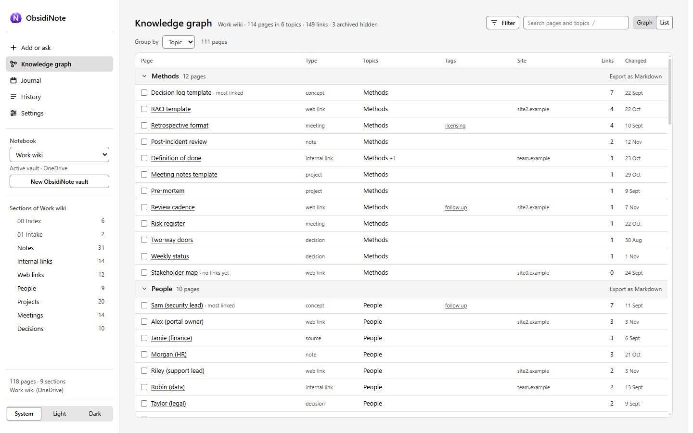

### The page window
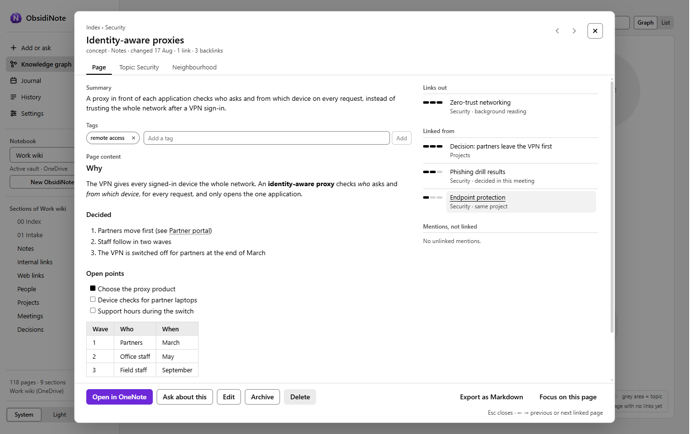

- The page's own text, read from OneNote when you open it (long pages up to 20,000 characters), its summary, tags, links out and **Linked from**. A link to another page opens it here; `←` `→` walk the linked pages.
- **Change the title or summary where they stand**: click, type, `Enter` saves, `Esc` puts it back. **Edit** changes the type, topics, aliases, a link's address and the links to other pages. The page text itself is changed in OneNote (**Open in OneNote**).
- **Ask about this**, **Export as Markdown**, **Focus on this page**.
- **Archive** puts a page out of the way (Archive / its section, left out of Ask, hidden on the map until you show archived pages); **Restore** or **Undo** brings it back. **Delete** sends it to OneNote's Deleted Pages, which keeps it 60 days. Both always ask first. Picking a type of another section in **Edit** moves the page there.

### Tags
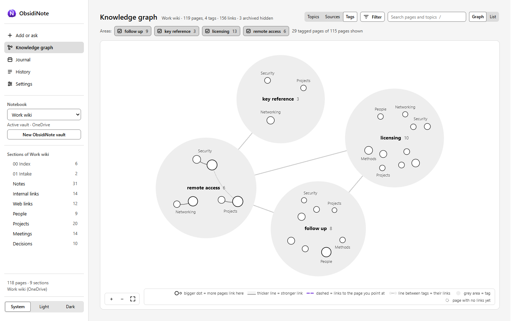

Your own labels, to relate pages that nothing else relates. Add them in the page window, or tick rows in the List and tag them together (the same ticked rows can be archived, restored, deleted, or have their link summaries read again with **Update summaries**). In the **Tags** view each tag is an area, with the pages of each topic together under the topic's name, so you see which topics a tag connects. Rename, merge or remove a tag under **Settings**. Copilot never sets or changes tags.

### Journal
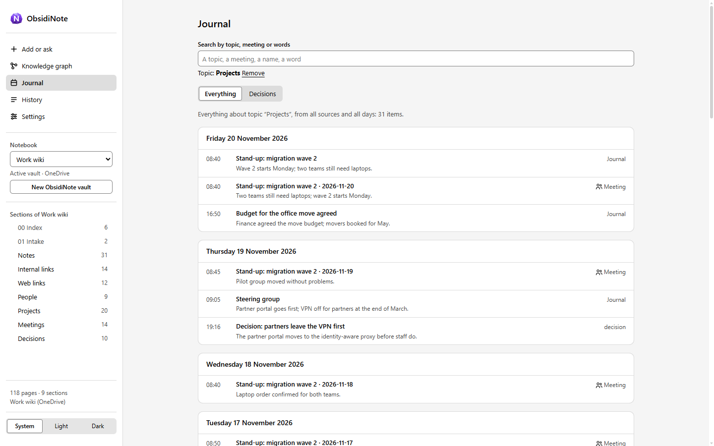

Your journal, one page per day: everything Copilot files as a journal entry (what happened, what you did or decided) goes into that day's page, with its time. Your meeting pages are listed too, with their start time and a meeting icon. Search it by topic or words to see everything about that topic from all your sources and all days, not only journal entries. With a topic chosen, **Decisions** lists the topic's decision pages with the pages each came from, and **Find decisions with Copilot** asks Copilot to find decisions written inside other pages (read only, citing them).

### More
- **Find** (`Ctrl+K`): jump to any page or topic.
- **History**: everything Add did (meetings included), with **Open** and **Undo**.
- **Web links** (link pages, Ask's sources, links in a page's text) open in a new tab of your default browser; OneNote links open OneNote.
- **Export as Markdown**: one page, a topic or the whole vault as Markdown files with `[[links]]`, for any Markdown editor. It goes to your downloads; nothing is kept.
- **Several vaults**: the **Notebook** switcher in the side bar lists your vaults and other open notebooks. One vault is active and written to; everything else is only read.
- **Read only**: when a vault cannot be changed from this window (another PC is writing in it, or you are looking at another vault or notebook), a banner above the content says why and what to do.
- **What's new**: after an update the window shows the changes once.

## Updates
ObsidiNote checks for a new release every time it starts and installs it before anything else loads. Your settings stay.

- Update now: double-click `update.cmd`.
- Go back to an earlier release: `update.cmd -To v0.8.4` (automatic updates then skip the release you left).
- Turn automatic updates off: `{ "autoUpdate": false }` in `config\obsidinote.local.json`, or start with `-NoUpdate`.

If an update cannot be installed, ObsidiNote says so and starts the version you had. Details are in `%LOCALAPPDATA%\ObsidiNote\logs\update.log`.

## When something does not work
- **Copilot does not sign in.**
  - `[WARN] Edge profile ... SSO off`: run `sso-setup.cmd` once, close ObsidiNote's Edge window, start again.
  - "Edge profile is already open ... without its debug port": close every window of ObsidiNote's Edge (check the taskbar), start again.
  - "Edge policy BrowserSignin = 2": sign in to Edge itself first, in the Edge window ObsidiNote opened, then start again.
  - "Edge policy RemoteDebuggingAllowed = 0": your organisation blocks what ObsidiNote needs to talk to Copilot. Ask IT to allow it.
  - "Copilot message box never appeared": sign in within 10 minutes and choose "Stay signed in", then start again.
- **Pages show "read only".** The banner says why. If it says another PC is writing, close ObsidiNote there; this window takes over within about two minutes. If you are looking at another vault, choose your vault under **Notebook**.
- **Without Copilot** (signed out, or started with `-NoCopilot`), Add and Ask say so; the graph, reading and editing pages still work.
- **Check this PC step by step**: the validation kit in the `validation` folder runs the checks and writes a log to your Desktop that holds no content, only counts and yes/no. Start with `docs/runbooks/RB-00-overview.md`.
- **Still stuck**: send the last 30 lines of `%LOCALAPPDATA%\ObsidiNote\logs\obsidinote.log`. It holds ids, counts and timings, never your content.

## Privacy
Everything ObsidiNote knows lives in your own OneNote notebook: your pages, the intake, the index and its links. ObsidiNote keeps no copy on disk and reads the notebook while it runs, so the notebook's own protection (OneDrive or SharePoint, your organisation's labels and retention) covers all of it. Text you add is sent to Microsoft 365 Copilot in your own browser session; nothing goes to any other service. On disk ObsidiNote keeps only a small settings file, backups of its own program files, and logs without content, in `%LOCALAPPDATA%\ObsidiNote`. The Edge profile ObsidiNote uses for Copilot lives there too.

## Settings and options
**Settings** (in the menu) are kept in the vault, so every PC that opens it uses the same:
- which company addresses count as internal links (Microsoft 365, company SaaS tenants and hosts with your company's name already do);
- how many related pages Add links a new page to (3), how many pages Ask reads (20), after how many days Ask offers to update a link page (90);
- whether Ask includes archived pages, and how the graph opens (Topics or Sources, "Labels: hubs only", archived pages);
- your tags (rename, merge, remove).

Per PC, in `config\obsidinote.local.json` (made for you; it survives updates):

| Setting | Default | What it does |
|---|---|---|
| `uiPort` | `8767` | Port of the ObsidiNote window, on this computer only |
| `cdpPort` | `9334` | Port of ObsidiNote's Edge window, on this computer only |
| `signIn` | `single-sign-on` | `private` opens Copilot in a private session (sign in at every start) |
| `autoUpdate` | `true` | `false` stops the update at start |

Start options (`Start ObsidiNote.cmd` passes them on): `-NoCopilot` (or `OBSIDINOTE_NO_COPILOT=1`), `-NoOneNote`, `-NoWindow` (or `OBSIDINOTE_NO_WINDOW=1`), `-NoUpdate` (or `OBSIDINOTE_NO_UPDATE=1`). Exit codes: 1 a check failed, 2 OneNote not available, 3 Copilot could not be reached, 4 the window's server could not start.

## For developers
```
obsidinote.ps1        entry point: the start sequence, then the window's local server
lib/                  Windows PowerShell 5.1 modules (server, OneNote, vault, index, Add, Ask, Copilot bridge)
ui-src/               the interface: React + Vite + TypeScript; `npm run build` writes ui/
ui/                   the built interface (committed; no Node needed to run ObsidiNote)
tests/                Pester 3.4 tests; tests/fixtures holds data both test suites read
validation/           the validation kit (Run Validation.cmd and friends), docs/runbooks/ its steps
tools/                run-tests.ps1, build-release.ps1, update.ps1, sso-setup.ps1
config/               obsidinote.json (defaults); *.local.json stay local
```
- Tests: `powershell -NoProfile -File tools/run-tests.ps1` (also fails on non-ASCII script files). Interface: in `ui-src`, `npm install` once, then `npm run typecheck`, `npm test`, `npm run build`.
- Rendered checks of the interface and the README screenshots: see `AGENTS.md` (`scripts/check-design-rules.mjs`, `scripts/check-control-rows.mjs`, `scripts/readme-shots.mjs`).
- Releases: `tools/build-release.ps1`, described in `AGENTS.md` → Releasing. Design and product decisions: `FEASIBILITY.md`, `DESIGN.md`, `PRODUCT.md`. Build status: `docs/STATUS.md`.

The screenshots show invented example content.
