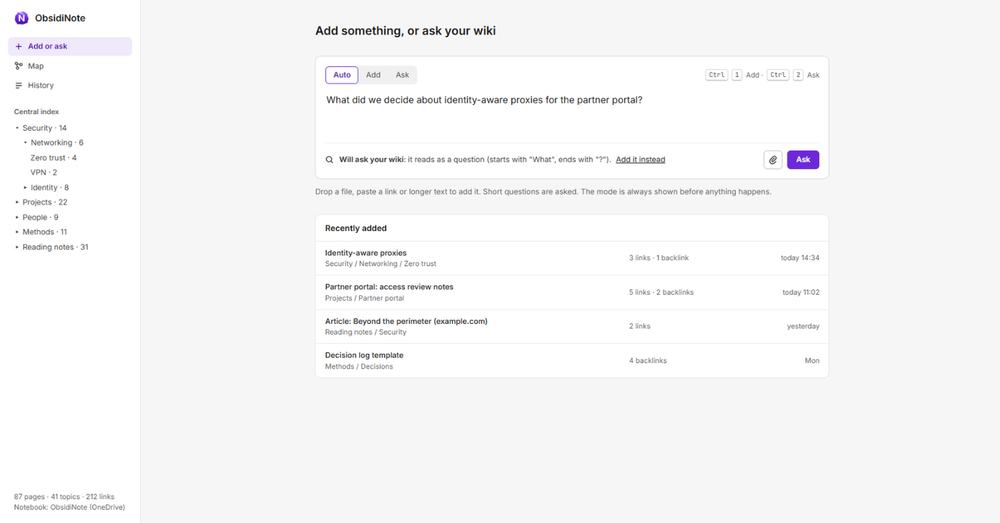
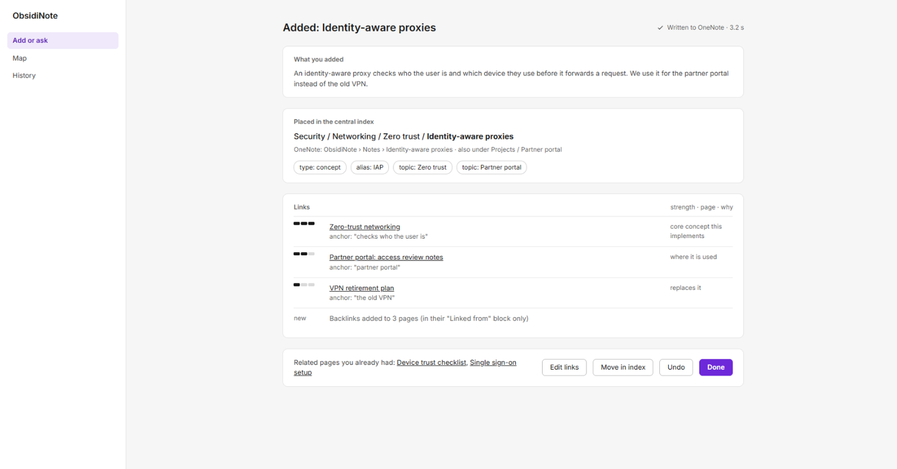
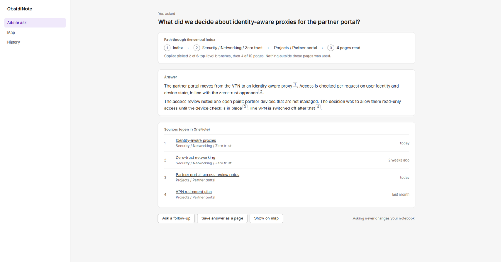
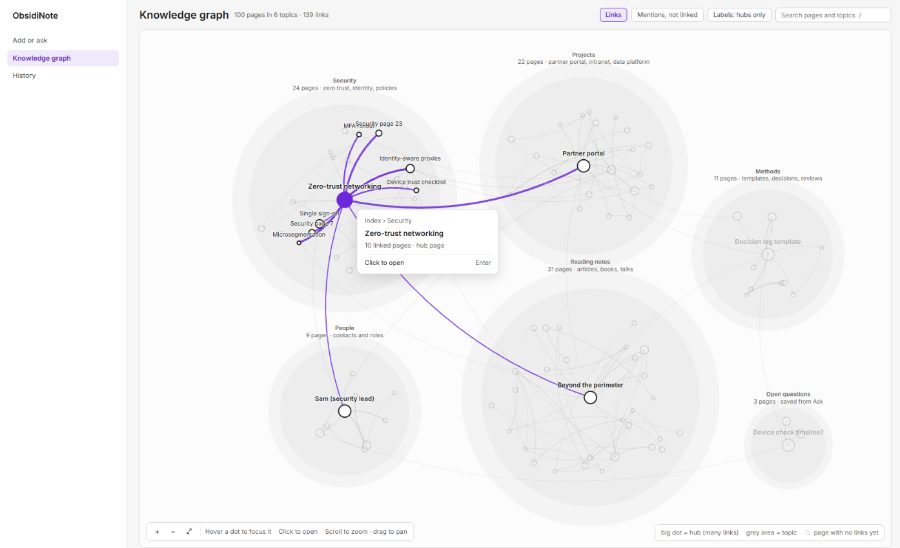
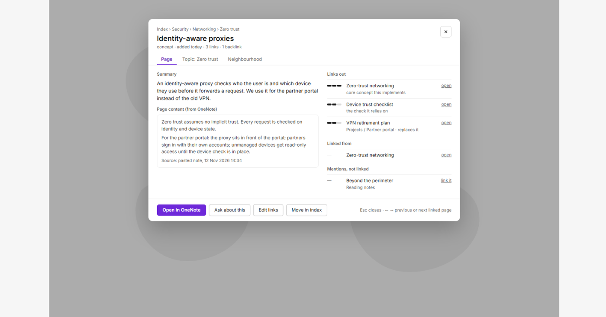

# ObsidiNote


A personal wiki that links itself: add anything, and Microsoft 365 Copilot files it into OneNote, linked to related pages and topics.

Status: feasibility stage. See `FEASIBILITY.md` and `docs/STATUS.md`.

## Quick start
```powershell
powershell -NoProfile -ExecutionPolicy Bypass -File obsidinote.ps1 -Name World
```

## Features
Planned:
- **Add**: paste text, a link or a file; it becomes a OneNote page with topics, links and backlinks.
- **Ask**: ask a question; the answer cites your own pages, and each citation opens in OneNote.
- **Map**: a graph of everything, clustered by topic, with edges weighted by relevance.

## Screenshots
Design mock-ups of the planned interface, with invented example content.

**Add or ask from one box.** ObsidiNote says what it will do before it does it.


**Add.** The new page's place in the central index, its topics, and every link with its strength and reason.


**Ask.** The answer shows the path it took through the index and cites your own pages.


**Knowledge graph.** Pages are dots, topics are grey areas, and links are lines weighted by relevance. Hovering a page focuses it and its neighbours.


**Page details.** Clicking a dot opens the page with its links, backlinks and mentions.


## Configuration
Copy `.env.example` to `.env` (if present). Every key has a working default; optional keys
switch features off instead of crashing.

## Updates
ObsidiNote checks for an update every time it starts, before anything else loads:
- In a git clone on `main` without local changes it runs `git pull --ff-only`.
- In a folder unpacked from a release it compares `version.txt` with the latest release on GitHub, downloads `ObsidiNote-vX.Y.Z.zip`, checks it against `SHA256SUMS`, and copies it in. Your `config\*.local.json` files stay. If another program has a file open, the update waits and names the file; if the copy fails halfway, the previous version is put back.
- Each start also checks the folder against the release's `manifest.json` and reinstalls the same version once if files are missing or changed.

Problems never stop ObsidiNote; they are reported on stderr and in `%LOCALAPPDATA%\ObsidiNote\logs\update.log`.

- Update now: `update.cmd`
- Go back to an earlier release: `update.cmd -To v0.1.3` (automatic updates then skip the release you left and take the next newer one; remove `skipUpdates` from `config\obsidinote.local.json` to undo)
- Turn automatic updates off: `{ "autoUpdate": false }` in `config\obsidinote.local.json`, or start with `-NoUpdate`, or set `OBSIDINOTE_NO_UPDATE=1`

## Privacy
Everything ObsidiNote knows lives in your own OneNote notebook: your pages, the inbox, the central index and its links. ObsidiNote keeps no copy on disk; it reads the notebook while it runs, so the notebook's own protection (OneDrive or SharePoint, your organisation's labels and retention) covers all of it. Text you add is sent to Microsoft 365 Copilot in your own browser session to classify and link it; nothing goes to any other service. On disk it keeps only files without content: a small settings file, and the updater's backups of the app's own files and its log in `%LOCALAPPDATA%\ObsidiNote`.

## Project layout
```
obsidinote.ps1         entry point (parameters, I/O)
lib/Core.psm1        pure functions
lib/Update.psm1      update helpers: versions, files in use, backup, manifest, checksums
config/              obsidinote.json (defaults); *.local.json stay local and survive updates
tests/*.Tests.ps1    Pester 3.4 (inbox) syntax: Should Be
tools/               run-tests.ps1, build-release.ps1, update.ps1
update.cmd           update now (or -To vX.Y.Z to go back)
```

## Tests
`tools/run-tests.ps1` runs Pester over `tests/` and fails if any script file contains non-ASCII bytes.

## Release
See `AGENTS.md` → Releasing.
